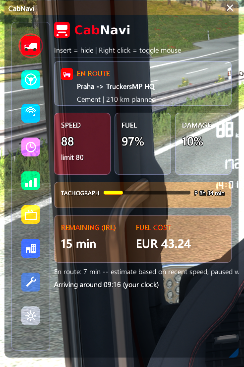
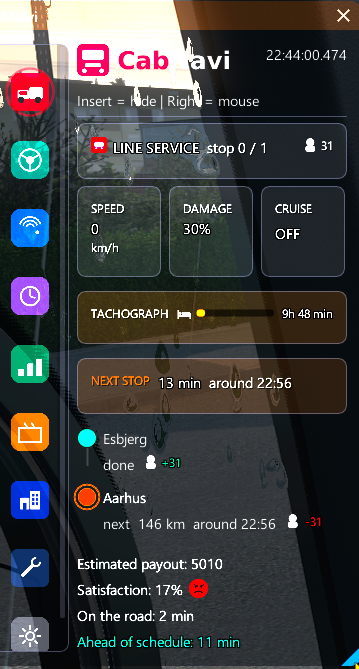
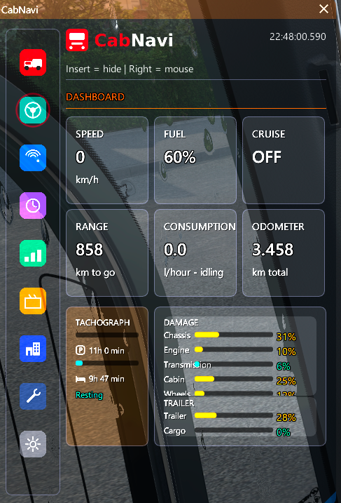
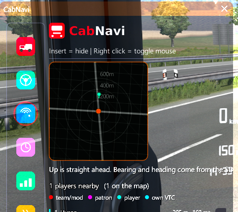
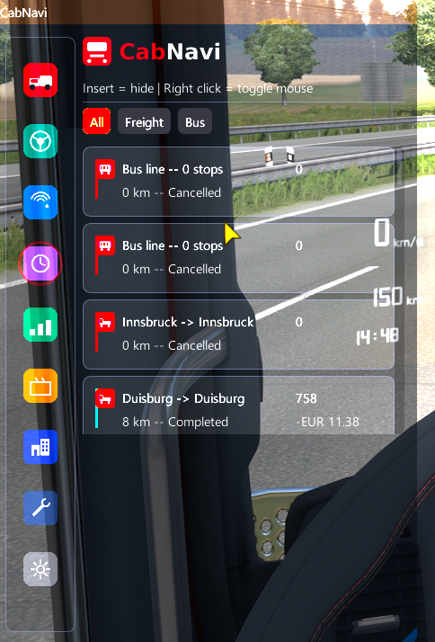
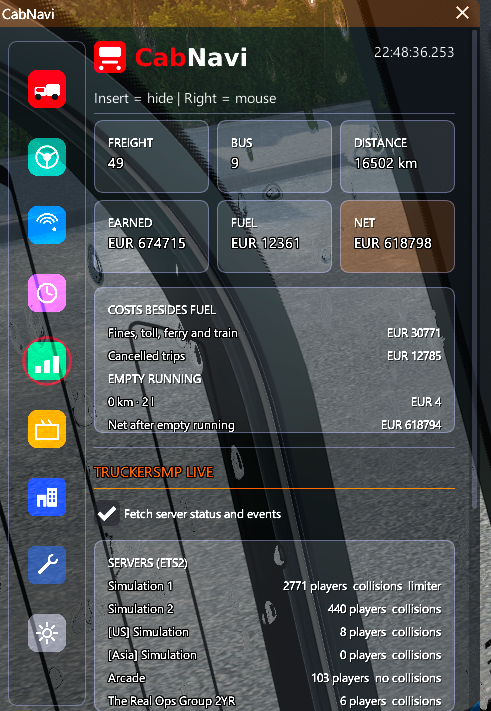
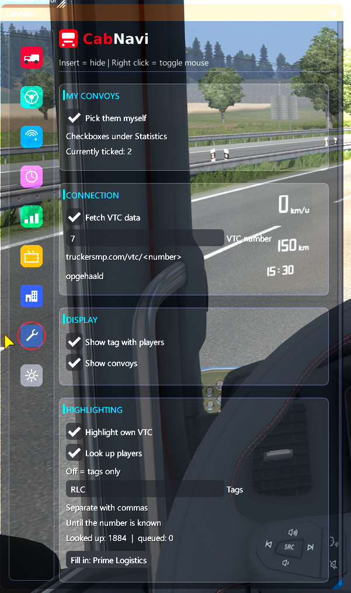
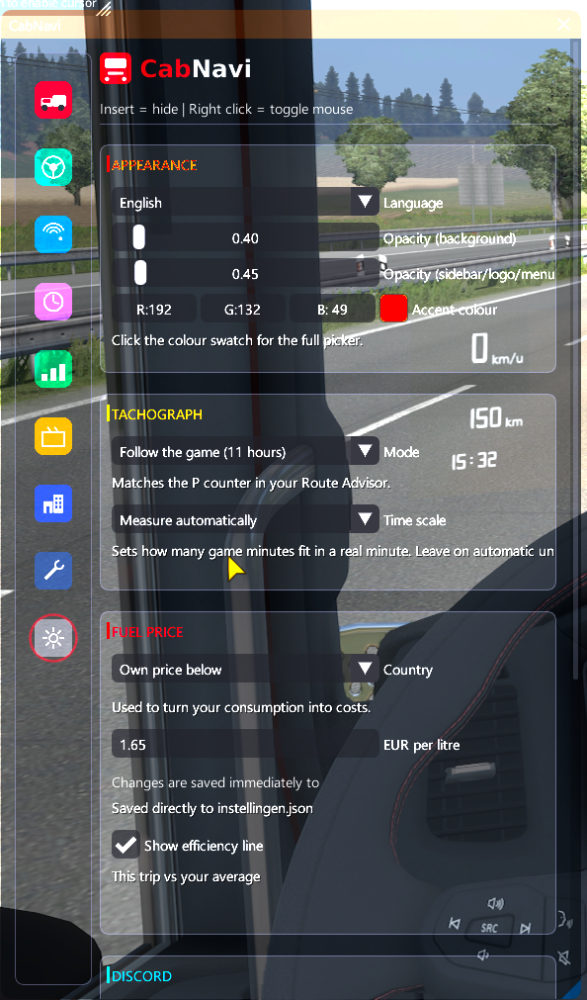
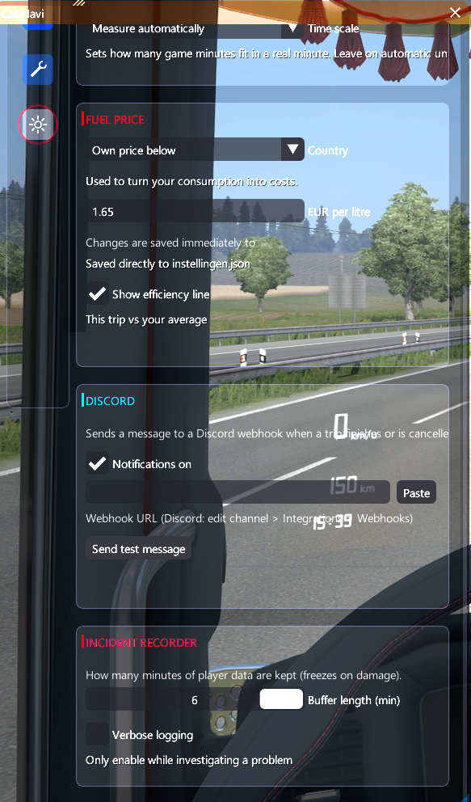

  

  An in-game HUD overlay and trip logbook for <b>TruckersMP</b> (Euro Truck Simulator 2 and American Truck Simulator)

---

CabNavi draws a clean, resizable panel on top of the game with everything a
driver keeps an eye on: live speed and fuel, your own tachograph, damage,
nearby players on a radar, a full trip history, and your VTC's convoys. It
records every job you finish so you can look back at what you drove, what it
cost, and how you are doing over time.

> **Not affiliated with SCS Software or TruckersMP.** CabNavi is an
> unofficial third-party plugin. All trademarks are the property of their
> respective owners.

---

## Screenshots

| Live &mdash; freight | Live &mdash; bus | Dashboard |
|---|---|---|
|  |  |  |

| Players | Trip log | Statistics |
|---|---|---|
|  |  |  |

| VTC settings | Settings | Settings (continued) |
|---|---|---|
|  |  |  |

---

## Features

**On the road**
- Live speed with the current limit, fuel level, cruise control and range
- Fuel consumption in km/l or mpg, switching to l/hour when you are standing still
- Units follow the game (metric in ETS2, imperial in ATS) or your own choice
- Your own tachograph: follow the game, your own rules, or EU driving times
- Damage for truck, trailer and cargo at a glance
- Efficiency line: how this trip compares to your own average

**Around you**
- Radar with nearby players, real bearing and heading from vehicle positions
- Role colours for staff, patrons and members of your own VTC
- Long combinations marked separately
- Distance and ping per player

**Your trips**
- Every freight job and bus line logged automatically
- Coaches DLC (ETS2): line services and tourist rides in the live bus view,
  with stops, passengers on board and live satisfaction
- Distance, income, fuel used, fuel cost, damage and delays
- Estimated arrival time in real time, not game time
- Incident recorder: freezes the last few minutes of player data when you
  take damage, so you can see who was around
- Optional Discord message when a trip finishes

**VTC integration** (optional)
- Your company, member count, own convoys and the events it attends
- Company news
- Highlight fellow members on the radar and in the player list
- Convoy reminder on the Live tab when one starts within the hour
- Your own schedule for the coming month
- Pick where your company lives -- the CabNavi Discord bot, Trucky, Horizon
  Dispatch or TruckersHub -- and see its members, convoys, news and your
  jobs on the VTC tab. Jobs dispatched from the bot can be accepted in the cab
- Send finished trips to your company's own system with the VTC webhook, in
  CabNavi's open format or the signed-envelope format that open-source
  Drivers Hubs (such as the Drivers Hub Project / CHub) accept out of the box

**Other**
- Dutch and English, switchable in the settings
- Your own logo in the header
- Everything can be turned off; nothing contacts the internet unless you
  enable it

---

## Installation

1. Download **CabNavi-x.y.z-setup.exe** from the [Releases](../../releases) page.
2. Run it: Next, Next, Finish. Setup finds Euro Truck Simulator 2 and
   American Truck Simulator (Steam registry and all library folders),
   installs the plugin into `<game>\bin\win_x64\plugins\` of every game
   it finds, and puts the icons and default logo in `%APPDATA%\CabNavi\`.
   Only if it finds neither game does it ask for a folder.
3. Start the game through TruckersMP. Press **Insert** to show or hide the
   overlay, and **right click** to toggle the mouse.

Uninstall via *Apps & features*; that removes the plugin and icons but keeps
your trips and settings.

### Your own logo

Put a transparent `logo.png` in `%APPDATA%\CabNavi\`. It is drawn 32 pixels
high; around 64 pixels high and under 320 wide stays sharp. No logo file
means CabNavi shows its name as text.

### Your data

Trips and settings are stored in `%APPDATA%\CabNavi\` on your own PC.

---

## What CabNavi reads

- **Read only, always.** CabNavi uses what the game and TruckersMP provide,
  plus your save and the game archives with read access only. It never
  writes to them and changes nothing in the game.
- **Network.** Two switches, both on by default: *Server data and events*
  (the TruckersMP Web API) and *Update map data via internet* (a plain
  download from this repository). Switch either off under Statistics and
  CabNavi never contacts that host.
- More detail in [PRIVACY.md](PRIVACY.md).

---

## Contributing

Issues and pull requests are welcome. The interface is available in both
Dutch and English.

## License

GPL-3.0. See [LICENSE](LICENSE).
